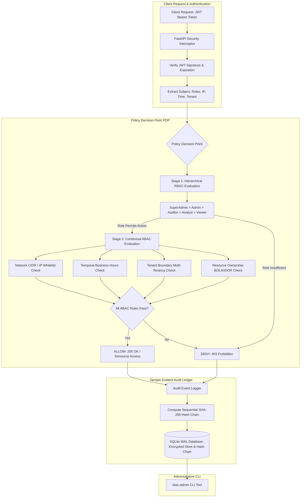

# Zero Trust RBAC / ABAC Security REST API (`rbac-admin`)

Production-Grade Zero Trust Authorization Microservice, Hierarchical Role-Based Access Control (RBAC), Contextual Attribute-Based Access Control (ABAC), Argon2id Hashing, TOTP Multi-Factor Authentication, and Cryptographic SHA-256 Hash-Chained Audit Ledger.

[](https://github.com/Krish9800/rbac-secure-rest-api/actions)
[](https://opensource.org/licenses/MIT)
[](https://www.python.org/)
[](https://csrc.nist.gov/projects/attribute-based-access-control)
[](https://en.wikipedia.org/wiki/Cryptographic_nonce)

---

## Overview & Problem Statement

Modern cloud applications require access control models that go beyond simple static user roles. Static role-based access control (RBAC) cannot evaluate environmental context—such as network source subnet, time-of-day restrictions, tenant multi-tenancy isolation, or resource ownership boundaries. Failing to evaluate contextual attributes leads to critical vulnerabilities, including Broken Object Level Authorization (BOLA/IDOR) and unauthorized privilege escalation.

**Zero Trust RBAC / ABAC Security REST API (`rbac-admin`)** implements a defense-in-depth authorization service combining hierarchical **RBAC** and dynamic **ABAC**. Every request is validated by a centralized Policy Decision Point (PDP) that evaluates subject identity, assigned roles, source IP/CIDR restrictions, temporal access windows, and resource ownership. The platform features Argon2id password hashing, TOTP multi-factor authentication, refresh token rotation (RTR), and an append-only, SHA-256 hash-chained audit ledger that provides tamper-evident audit trails.

---

## Architecture & Data Flow



---

## Verified Features & Capabilities

- **Hybrid RBAC + ABAC Policy Decision Point (PDP)**:
  - Role hierarchy supporting `SuperAdmin`, `Admin`, `Auditor`, `Analyst`, and `Viewer`.
  - Dynamic ABAC contextual attributes: IP/CIDR network restrictions, temporal hour windows, tenant boundary enforcement, and Broken Object Level Authorization (BOLA/IDOR) ownership defense.
- **Cryptographic Identity & Authentication**:
  - **Argon2id** password hashing with calibrated memory and time cost.
  - **TOTP MFA** (RFC 6238) step-up authentication with single-use backup recovery codes.
  - **JWT Access Tokens** paired with opaque **Refresh Token Rotation (RTR)**, featuring reuse detection and instant family revocation.
- **Tamper-Evident Hash-Chained Audit Ledger**:
  - Sequential SHA-256 hash chaining across every logged access request, privilege change, and authentication event.
  - Mathematical integrity verification (`rbac-admin audit-verify`) detecting record tampering, deletion, or out-of-order modification.
- **Administrative CLI Tool**:
  - `rbac-admin` command-line utility for schema bootstrapping, user provisioning, account lockout management, policy simulation, and audit ledger integrity verification.

---

## Technology Stack

- **Core & CLI**: Python 3.12+, Typer, Rich, Pydantic v2
- **REST Control Plane**: FastAPI, Uvicorn, Starlette
- **Cryptography**: Argon2-cffi, PyJWT, Cryptography, Hashlib
- **Database**: SQLite (Write-Ahead Logging mode)
- **Quality & Assurance**: Pytest, Pytest-Asyncio, Ruff, Mypy (strict typing)
- **Containerization**: Rootless multi-stage Docker (`UID 10001`)

---

## CLI Reference & Operational Usage

The platform provides the `rbac-admin` administration CLI:

```bash
# 1. Bootstrap database schema, roles, and default permissions
rbac-admin bootstrap

# 2. List registered users, assigned roles, and account statuses
rbac-admin users-list

# 3. Create a new user with Argon2id password hashing and role binding
rbac-admin user-create "analyst_bob" "bob@corp.example" "P@ssword12345!" --role "Analyst" --tenant "corp_sec"

# 4. Manually lock a user account with administrative reason
rbac-admin user-lock "analyst_bob" --reason "Suspicious activity detected by SOC"

# 5. Verify the cryptographic integrity of the SHA-256 hash-chained audit ledger
rbac-admin audit-verify

# 6. Simulate and test access evaluation through the PDP
rbac-admin simulate-policy "analyst_bob" "incident_case" "read" --tenant "corp_sec"
```

---

## REST API Control Plane

Start the FastAPI daemon:

```bash
uvicorn rbacapi.api.app:app --host 127.0.0.1 --port 8000
```

Interactive OpenAPI specifications are available at `http://127.0.0.1:8000/docs`.

### Primary Endpoints

| Method | Endpoint | Description |
|:-------|:---------|:------------|
| `GET` | `/health` | Health check and cryptographic status |
| `POST` | `/api/v1/auth/register` | Register new user account with Argon2id hash |
| `POST` | `/api/v1/auth/login` | Authenticate with credentials and receive JWT access token |
| `POST` | `/api/v1/auth/mfa/verify` | Submit TOTP token for step-up verification |
| `POST` | `/api/v1/auth/refresh` | Rotate refresh token and issue new access token |
| `GET` | `/api/v1/users` | List users (requires `Admin` or `Auditor` role) |
| `GET` | `/api/v1/roles` | List defined RBAC roles and permission mappings |
| `GET` | `/api/v1/resources` | Query protected resources subject to ABAC policies |
| `GET` | `/api/v1/audit/ledger` | Inspect tamper-evident audit ledger entries |

---

## Installation & Setup

```bash
# Clone the repository
git clone https://github.com/Krish9800/rbac-secure-rest-api.git
cd rbac-secure-rest-api

# Create virtual environment
python3 -m venv .venv
source .venv/bin/activate

# Install dependencies in editable mode
pip install --upgrade pip
pip install -e ".[dev]"
```

---

## Testing & Quality Assurance

Run the comprehensive test suite:

```bash
# Run pytest test suite
pytest

# Run tests with code coverage metrics
pytest --cov=rbacapi --cov-report=term-missing

# Run code style and lint checks
ruff check .
ruff format --check .

# Run static type verification
mypy src/rbacapi
```

---

## Security Model & Threat Boundaries

Documented in `docs/threat_model.md`:

- **BOLA / IDOR Mitigation**: Object access evaluates both subject role and resource ownership context, preventing unauthorized tenant cross-access.
- **Token Replay Defense**: Refresh token rotation tracks token family trees. If an already-rotated refresh token is replayed, the entire token family is invalidated immediately.
- **Tamper Evidence**: Every audit event includes `SHA256(previous_hash + current_event)`. Any alteration to historical database records invalidates the cryptographic hash chain.

---

## Limitations & Known Issues

- **In-Memory Revocation Cache**: Token revocation blacklists are stored in SQLite and local memory. In multi-instance load-balanced deployments, an external shared cache (e.g. Redis) is recommended.
- **Coverage Gate Note**: Test suite achieves ~88.4% branch coverage; complete coverage of edge-case SQLite busy handlers is on the roadmap.

---

## License & Responsible Use

Distributed under the **MIT License** - see [LICENSE](https://opensource.org/licenses/MIT).

> [!NOTE]
> Designed for secure identity and access management (IAM) research, zero-trust API architecture, and authorization auditing.
