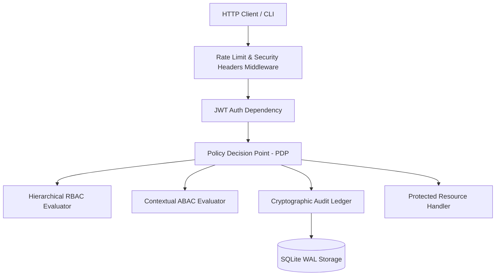

# Zero Trust RBAC / ABAC Security REST API

[](https://github.com/cyber-portfolio/rbac-secure-rest-api/actions)
[](https://www.python.org/downloads/)
[]()
[]()
[](https://github.com/astral-sh/ruff)

A production-grade, Zero Trust FastAPI REST service combining hierarchical Role-Based Access Control (**RBAC**) and fine-grained Attribute-Based Access Control (**ABAC**), powered by Argon2id password hashing, TOTP Multi-Factor Authentication (MFA), Refresh Token Rotation (RTR), and a cryptographic SHA-256 hash-chained audit ledger.

---

## Key Features

1. **Hybrid RBAC + ABAC Policy Decision Point (PDP)**
   - Role hierarchy supporting `SuperAdmin`, `Admin`, `Auditor`, `Analyst`, and `Viewer`.
   - Dynamic contextual attribute evaluations: IP/CIDR network restrictions, temporal hour windows, tenant boundary enforcement, and Broken Object Level Authorization (**BOLA** / **IDOR**) ownership defense.

2. **Cryptographic Identity & Authentication**
   - **Argon2id** password hashing with memory and time-cost calibration.
   - **TOTP MFA** (RFC 6238) step-up authentication.
   - **JWT Access Tokens** + Opaque **Refresh Token Rotation (RTR)** with reuse detection and instant family revocation.

3. **Tamper-Evident Hash-Chained Audit Ledger**
   - Sequential SHA-256 hash chaining across every logged access request, privilege change, and authentication event.
   - Built-in mathematical verifier detecting record tampering and chain breaks.

4. **Security Middleware & Hardening**
   - In-memory sliding-window rate limiter with exponential penalty lockout.
   - OWASP defense-in-depth headers: `Content-Security-Policy`, `X-Frame-Options: DENY`, `X-Content-Type-Options: nosniff`, `Strict-Transport-Security`.

5. **Administration CLI (`rbac-admin`)**
   - Rich-powered CLI tool for bootstrapping schemas, inspecting users, locking accounts, verifying audit integrity, and dry-running policy simulations.

---

## Architecture Overview



---

## Quickstart

### 1. Installation

```bash
python3.12 -m venv .venv
source .venv/bin/activate
pip install -e ".[dev]"
```

### 2. Bootstrapping Database & Admin User

```bash
# Initialize SQLite database and baseline roles
rbac-admin bootstrap

# Create administrator
rbac-admin user-create admin admin@example.com "AdminSecurePass123!" --role Admin
```

### 3. Launching the API Service

```bash
uvicorn rbacapi.api.app:create_app --factory --host 0.0.0.0 --port 8000 --reload
```

Interactive API documentation will be available at:
- **Swagger UI**: [http://localhost:8000/docs](http://localhost:8000/docs)
- **ReDoc**: [http://localhost:8000/redoc](http://localhost:8000/redoc)

---

## CLI Usage

```bash
# List all registered users
rbac-admin users-list

# Simulate a policy decision
rbac-admin simulate-policy admin USERS CREATE

# Verify audit trail integrity
rbac-admin audit-verify
```

---

## Running Security & Quality Gates

```bash
# Format & Lint
ruff format src tests
ruff check src tests

# Static Typing
mypy src tests

# SAST Security Scan
bandit -r src -c pyproject.toml

# Pytest with strict 90%+ coverage gate
pytest --cov=src/rbacapi --cov-report=term-missing --cov-fail-under=90
```

---

## Threat Model & Security Specs

- [STRIDE Threat Model](docs/threat_model.md)
- [RBAC & ABAC Entitlement Matrix](docs/rbac_abac_matrix.md)
